# Charterloom AI

**Intelligent Workflow and Template Recommender for Custom Project Lifecycles**

Charterloom AI reads a project charter, retrieves evidence from an organisational archive of historical project blueprints, post mortems and delivery methodologies, recommends the workflow archetype most likely to succeed, and generates a tailored, validated state machine configuration ready for a project management backend. Every recommendation arrives with calibrated confidence, the precedents behind it, cited methodology passages and a changelog that explains each customisation.

# Charterloom AI: System Architecture

Charterloom AI turns a free-text project charter into a validated, citation-backed workflow. The pipeline runs in five stages: **ingestion → representation → retrieval → reasoning → output**.

```mermaid
flowchart LR

    subgraph S1["1 · Inputs"]
        direction TB
        PC(["Project Charter<br/>Free-text requirements"])
        KB[("Knowledge Base<br/>Blueprints · Post-mortems<br/>Methodologies · Templates")]
    end

    subgraph S2["2 · Representation"]
        direction TB
        FE["Feature Extractor<br/>Signals · Team · Regimes"]
        SE["Semantic Embedder<br/>TF-IDF + LSA"]
    end

    subgraph S3["3 · Retrieval"]
        direction TB
        PSI["Project Space Index<br/>Nearest precedents"]
        HR["Hybrid Retriever<br/>BM25 + Dense · RRF fusion"]
    end

    subgraph S4["4 · Reasoning"]
        direction TB
        RH["Recommendation Head<br/>Semantic · Structural ·<br/>Precedent experts"]
        CU["Customizer<br/>Parameters · Overlays ·<br/>Evidence adjustments"]
    end

    subgraph S5["5 · Output"]
        VW[["Validated Workflow<br/>State-machine JSON<br/>Rationale · Citations"]]
    end

    PC -->|charter text| FE
    PC -->|charter text| SE
    FE -->|feature vector| PSI
    SE -->|embedding| PSI
    KB -.->|indexed corpus| PSI
    SE -->|query vector| HR
    KB -.->|documents| HR
    PSI -->|top-k precedents| RH
    PSI -->|precedent context| CU
    HR -->|ranked evidence| CU
    RH ==>|base recommendation| CU
    RH ==>|selected blueprint| VW
    CU ==>|tailored workflow| VW

    classDef input fill:#EEF2FF,stroke:#4F46E5,stroke-width:1.5px,color:#1E1B4B
    classDef store fill:#ECFDF5,stroke:#059669,stroke-width:1.5px,color:#064E3B
    classDef process fill:#F5F3FF,stroke:#7C3AED,stroke-width:1.5px,color:#2E1065
    classDef reason fill:#FFF7ED,stroke:#EA580C,stroke-width:1.5px,color:#431407
    classDef output fill:#F0FDF4,stroke:#16A34A,stroke-width:2.5px,color:#052E16

    class PC input
    class KB store
    class FE,SE,PSI,HR process
    class RH,CU reason
    class VW output

    style S1 fill:#FFFFFF,stroke:#CBD5E1,stroke-dasharray:4 3
    style S2 fill:#FFFFFF,stroke:#CBD5E1,stroke-dasharray:4 3
    style S3 fill:#FFFFFF,stroke:#CBD5E1,stroke-dasharray:4 3
    style S4 fill:#FFFFFF,stroke:#CBD5E1,stroke-dasharray:4 3
    style S5 fill:#FFFFFF,stroke:#CBD5E1,stroke-dasharray:4 3

    linkStyle 4,6 stroke:#059669,stroke-width:1.5px
    linkStyle 10,11,12 stroke:#EA580C,stroke-width:2.5px
```



### Legend

| Shape / colour | Meaning |
|---|---|
| Rounded, indigo | External input |
| Cylinder, teal | Persistent knowledge store |
| Rectangle, violet | Representation and retrieval components |
| Rectangle, orange | Reasoning and decision components |
| Double-bordered, green | Final system output |
| Solid arrow | Primary data flow |
| Dashed arrow | Corpus / knowledge-base access |
| Thick arrow | Decision path to output |

## Components

| Stage | Component | Responsibility | Key techniques |
|---|---|---|---|
| 1 · Inputs | **Project Charter** | Free-text statement of project goals, scope and constraints | — |
| 1 · Inputs | **Knowledge Base** | Curated corpus of prior project knowledge | Blueprints, post-mortems, methodologies, templates |
| 2 · Representation | **Feature Extractor** | Derives structured signals from the charter | Signal, team and regime extraction |
| 2 · Representation | **Semantic Embedder** | Encodes the charter into a dense semantic vector | TF-IDF + Latent Semantic Analysis |
| 3 · Retrieval | **Project Space Index** | Locates the most similar historical projects | Nearest-neighbour search over precedents |
| 3 · Retrieval | **Hybrid Retriever** | Fetches supporting evidence from the knowledge base | BM25 + dense retrieval, Reciprocal Rank Fusion |
| 4 · Reasoning | **Recommendation Head** | Selects the best-fit workflow blueprint | Mixture of semantic, structural and precedent experts |
| 4 · Reasoning | **Customizer** | Tailors the blueprint to this charter | Parameter setting, overlays, evidence-based adjustments |
| 5 · Output | **Validated Workflow** | Deliverable consumed by downstream tools | State-machine JSON with rationale and citations |

## End-to-end flow

1. The **charter** is processed in parallel by the **Feature Extractor** (structured signals) and the **Semantic Embedder** (dense vector).
2. Both representations query the **Project Space Index** to find the nearest precedent projects; the embedding also drives the **Hybrid Retriever** over the knowledge base.
3. The **Recommendation Head** combines its experts over the retrieved precedents to choose a base blueprint.
4. The **Customizer** adapts that blueprint using precedent context and ranked evidence.
5. The result is emitted as a **Validated Workflow**: a state-machine definition, with the rationale and citations behind every decision.

## Project Brief

Every organisation that runs more than a handful of projects eventually discovers that one workflow does not fit all. A customer facing feature with evolving requirements thrives in short Scrum sprints. A billing platform drowning in incident tickets needs Kanban flow with tight WIP limits. A clinical data capture module needs traceability, segregated approvals and electronic signatures because a regulator will inspect it. A smart meter firmware release needs formal stage gates because hardware cannot be changed after tooling is cut. Yet the choice of workflow is usually made in the first week of a project, by whoever sets up the board, from habit rather than evidence.

The cost of that habit is significant and largely invisible. Teams spend months working around a lifecycle that fights the nature of their work. Security and privacy findings surface days before launch because no review gate existed. Migrations overrun because nobody rehearsed the cutover. Regulated releases fail audit because approval evidence was retrofitted. The organisation usually already knows how to avoid these failures: the lessons sit in post mortems and project archives that nobody reads at the moment the decision is made. In the synthetic archive that ships with this repository, the workflow that people historically chose matched the best available workflow only 57.5 percent of the time.

Charterloom closes that gap by putting the archive to work at the point of decision. It treats workflow selection as a retrieval augmented classification problem and workflow design as an evidence driven configuration problem. The charter is embedded and profiled, similar historical projects are retrieved, three complementary experts estimate which workflow archetype fits best, and a customizer splices in the gates, guards, automations and ceremonies that similar projects needed, together with the controls that detected regulations demand. The output is not advice to be interpreted but a validated state machine that a backend can load directly, accompanied by a transparent rationale that a delivery lead can audit in minutes.

On held out projects, Charterloom agrees with the latent optimal workflow 80.0 percent of the time, compared with 57.5 percent for the historical human choice and 58.1 percent for a hand written rules baseline. It selects the right workflow adjustments with an F1 of 0.773, and every one of the 480 configurations it generated during evaluation passed structural and compliance validation, at a median latency of 83 milliseconds.

## Headline Results

<table>
<thead><tr><th>Capability</th><th>Measure</th><th>Result</th></tr></thead>
<tbody>
<tr><td>Workflow recommendation</td><td>Accuracy on held out high performing projects</td><td>0.740</td></tr>
<tr><td>Workflow recommendation</td><td>Top 3 accuracy</td><td>0.949</td></tr>
<tr><td>Workflow recommendation</td><td>Agreement with latent optimal workflow (all held out projects)</td><td>0.800</td></tr>
<tr><td>Historical human choice</td><td>Agreement with latent optimal workflow</td><td>0.575</td></tr>
<tr><td>Calibration</td><td>Expected calibration error</td><td>0.072</td></tr>
<tr><td>Selective prediction</td><td>Accuracy on the 84.3 percent of charters above the review threshold</td><td>0.803</td></tr>
<tr><td>Precedent retrieval</td><td>Mean reciprocal rank, hybrid project space</td><td>0.493</td></tr>
<tr><td>Workflow customization</td><td>Adjustment selection F1</td><td>0.773</td></tr>
<tr><td>Generated configurations</td><td>Valid state machines</td><td>480 of 480</td></tr>
<tr><td>Serving</td><td>Median and 95th percentile latency</td><td>83 ms and 136 ms</td></tr>
</tbody>
</table>

## What Charterloom Produces

For each charter Charterloom returns a single JSON document containing:

* **Recommendation**: the chosen workflow archetype, a calibrated probability for each of the eight archetypes, the probability from each expert, the blend weights, a review flag when confidence falls below the threshold, and the charter features that pushed hardest towards the decision.
* **Evidence**: the most similar historical blueprints with their outcomes, the post mortems whose lessons shaped the configuration, and methodology passages from the knowledge base.
* **Configuration**: states with categories, WIP limits, service levels and entry and exit criteria; transitions with guards and actions; event driven triggers; ceremonies; roles; metrics; and compliance metadata. The release transition is flagged explicitly.
* **Adjustments**: every candidate adjustment with its evidence support, charter prior, combined score, whether a regulation mandated it, and the identifiers of the supporting post mortems.
* **Changelog**: each change made to the base template with its reason and evidence.
* **Validation report**: errors, warnings and graph statistics from the state machine validator.

## The Eight Workflow Archetypes

<table>
<thead><tr><th>Archetype</th><th>Best suited to</th><th>Distinctive controls</th></tr></thead>
<tbody>
<tr><td>Agile Scrum Product Delivery</td><td>Evolving product features, one or two teams</td><td>Sprint cadence, pull request linkage, product owner acceptance</td></tr>
<tr><td>Kanban Continuous Flow</td><td>Maintenance and interrupt driven support</td><td>Classes of service, WIP guard, aging work alerts</td></tr>
<tr><td>Regulated Compliance Pipeline</td><td>Modules under strict regulatory oversight</td><td>Traceability, independent validation, electronic signatures, CAPA</td></tr>
<tr><td>Stage Gate Phased Delivery</td><td>Hardware, firmware, fixed scope contracts</td><td>Steering committee gates, baseline change control</td></tr>
<tr><td>Scaled Agile Release Train</td><td>Programmes of four or more teams</td><td>Increment planning, dependency board, ROAM risks</td></tr>
<tr><td>Dual Track Discovery and Delivery</td><td>Research, machine learning feasibility</td><td>Hypotheses, kill criteria, evidence review, learning log</td></tr>
<tr><td>Scrumban Hybrid Flow</td><td>Small teams mixing roadmap and interrupts</td><td>Planning on demand, expedite lane</td></tr>
<tr><td>Change Controlled Operations</td><td>Infrastructure upgrades and migrations</td><td>Risk assessment, CAB approval, freeze windows, automatic rollback</td></tr>
</tbody>
</table>

## The Knowledge Base

The retriever feeds from a large organisational archive held in `data/knowledge_base`. It contains 4,830 documents and roughly 1.07 million words, split into 16,655 retrievable chunks.

<table>
<thead><tr><th>Collection</th><th>Documents</th><th>Content</th></tr></thead>
<tbody>
<tr><td>Historical project blueprints</td><td>2,400</td><td>Full charter, adopted workflow, state flow, applied adjustments, outcome score and six outcome metrics</td></tr>
<tr><td>Post mortem analyses</td><td>2,400</td><td>Blameless reviews with what went well, what did not, and recommended workflow adjustments</td></tr>
<tr><td>Methodology library</td><td>22</td><td>Hand written guidance on each archetype, state machine design, WIP and flow metrics, thirteen regulatory regimes, security and privacy gates, model governance, migrations, vendors, accessibility and release controls</td></tr>
<tr><td>Workflow templates</td><td>8</td><td>Canonical, validated state machines exported as JSON with an indexable description</td></tr>
</tbody>
</table>

The blueprints and post mortems are synthesised by a transparent generative model in `charterloom/knowledge/generator.py`, because real project archives are confidential. Each project receives latent attributes across 13 business domains and 12 initiative types: team shape, duration, requirements volatility, interrupt load, research uncertainty, criticality, change risk, migration, machine learning content, vendor dependence, public exposure, personal data, traffic, stakeholder breadth and regulatory regimes. A utility model with Gumbel noise turns these attributes into a latent optimal workflow. The organisation then adopts the optimal workflow 58 percent of the time, the runner up 27 percent of the time and something else otherwise. Outcomes depend on workflow fit and on whether needed adjustments were applied.

Charter text reveals each latent attribute only with 80 percent probability and occasionally injects misleading cues, so the text is a realistic, imperfect view of the truth. The latent labels are written to a separate `ground_truth` folder that is used only for evaluation and is never indexed. The full specification is in [`data/knowledge_base/DATASHEET.md`](data/knowledge_base/DATASHEET.md).


## How It Works

### 1. Charter profiling

`charterloom/features.py` turns free text into 70 interpretable features. Cue lexicons score twenty delivery signals, such as requirements volatility, unplanned work, research uncertainty, production criticality, change risk and data migration. Regular expressions read team size, team count, duration, interrupt share and sprint length. Pattern matching detects thirteen regulatory regimes, including UK GDPR, HIPAA, Sarbanes Oxley, PCI DSS, ISO/IEC 27001, FDA 21 CFR Part 11, IEC 62304, ISO 13485, DORA, NIS2, the FCA Consumer Duty, WCAG 2.2 and MiFID II, together with the business domain and initiative type when stated.

### 2. Semantic embedding

`charterloom/embeddings.py` fits a TF IDF model over unigrams and bigrams on the whole knowledge base, followed by a 256 dimensional truncated SVD (latent semantic analysis) and L2 normalisation. It runs fully offline and deterministically, and it explains 65 percent of the variance of a 13,657 term vocabulary. Any encoder exposing `fit` and `transform` can replace it.

### 3. Retrieval

Two indexes serve different purposes.

* **Hybrid document retriever.** Documents are split into section aware chunks of 170 words with 40 words of overlap. Each chunk is scored by Okapi BM25, implemented as a precomputed sparse weight matrix so that a query is one sparse matrix product, and by dense cosine similarity. The two rankings are fused with reciprocal rank fusion and pooled to document level. This index serves methodology citations and the free text search endpoint.
* **Project space index.** Charters are compared in a hybrid space that concatenates the semantic embedding with the standardised charter features. Two projects are therefore close when they read alike and also share delivery characteristics. This index supplies precedent blueprints and the post mortems that drive customisation. On held out projects it lifts mean reciprocal rank from 0.325 to 0.493 compared with text only retrieval.

### 4. Classification and recommendation head

`charterloom/recommender.py` stacks three experts:

* **Semantic expert**: multinomial logistic regression over the embedding plus standardised features, calibrated with Platt scaling across five folds.
* **Structural expert**: gradient boosted trees over the interpretable features, which capture threshold effects such as team count or interrupt share.
* **Precedent expert**: a similarity and outcome weighted vote over the 30 nearest high performing historical projects in the project space. This is the retrieval augmented component.

Out of fold predictions from all three experts are generated during training, and blend weights are chosen on the probability simplex to minimise log loss. The trained weights are 0.15 semantic, 0.70 structural and 0.15 precedent. The head is trained only on high performing projects, so it learns which workflows succeeded rather than which were merely common. Charters whose top probability falls below 0.50 are flagged for human review. A linear attribution model reports the charter features that contributed most to the chosen class.

### 5. Customizer

`charterloom/customizer.py` starts from the canonical template of the recommended archetype and applies four layers, logging every change:

1. **Parameter tuning**: WIP limits sized to the team (about 0.6 items per person in build states and 0.35 in review states, or two features per team on a release train), sprint length matched to the charter, and tighter service levels for production critical services.
2. **Evidence driven adjustments**: fifteen candidate adjustments are scored by blending similarity weighted support from the post mortems of the 15 nearest projects with a prior read from the charter. Gates are spliced into the graph in a fixed order (performance, security, privacy, accessibility, model validation, migration rehearsal, vendor acceptance, user acceptance), each with an approval guard, a required artifact and a failure path back to rework.
3. **Regulatory overlays**: audit trails for Sarbanes Oxley and Part 11, electronic signatures for Part 11, design history evidence for IEC 62304 and ISO 13485, DORA incident classification, the NIS2 24 hour early warning clock, Consumer Duty outcome evidence, PCI DSS scope reviews, HIPAA access reviews, GDPR retention reviews and MiFID II record retention. Strict regimes always receive segregation of duties on the release transition.
4. **Validation**: `charterloom/state_machine.py` checks for a single initial state, at least one terminal state, unique keys, valid references, reachability of every state, absence of trap states, valid WIP limits and service levels, trigger referential integrity, and segregation of duties for strict regimes.

The adjustment threshold is calibrated during training without any leakage. For 800 training projects, the customizer retrieves post mortems while excluding the project itself, then chooses the threshold that best reproduces that project's own observed post mortem recommendations. The current threshold is 0.50, with an F1 of 0.703 against observed recommendations.

## Worked Example: Clearwater Disputes

The charter in [`examples/charters/payments_dispute_portal.md`](examples/charters/payments_dispute_portal.md) describes a self service card dispute portal. Requirements will evolve with customer feedback, the team of nine deploys continuously behind feature flags, peak load reaches 2,400 requests per second, and the journey falls under PCI DSS v4.0, the FCA Consumer Duty and UK GDPR.

Charterloom recommends **Agile Scrum Product Delivery with 92 percent confidence**; 20 of the 30 most similar high performing projects used the same workflow. It then makes the following changes to the base template:

<table>
<thead><tr><th>Change</th><th>Reason</th></tr></thead>
<tbody>
<tr><td>Performance Testing gate before Done</td><td>Charter prior 1.00, supported by 41 percent of similar post mortems</td></tr>
<tr><td>Security Review gate</td><td>Mandated by PCI DSS v4.0</td></tr>
<tr><td>Privacy Impact Assessment gate</td><td>Mandated by UK GDPR</td></tr>
<tr><td>Feature flag required on release, progressive rollout automation</td><td>Charter prior 1.00, supported by similar post mortems</td></tr>
<tr><td>Monthly stakeholder demonstration</td><td>Six departments involved, supported by 47 percent of similar post mortems</td></tr>
<tr><td>Customer outcome assessment required on release</td><td>FCA Consumer Duty</td></tr>
<tr><td>Quarterly cardholder data scope review</td><td>PCI DSS v4.0</td></tr>
<tr><td>Quarterly data retention review</td><td>UK GDPR storage limitation</td></tr>
</tbody>
</table>


The full output, including evidence and rationale, is in [`examples/outputs/payments_dispute_portal.json`](examples/outputs/payments_dispute_portal.json). The other six example charters cover a clinical trial data capture module, a billing support service, a claims fraud machine learning study, a core ledger migration, a public sector benefits programme and a smart meter firmware rollout.

<table>
<thead><tr><th>Example charter</th><th>Recommended workflow</th><th>Confidence</th><th>States</th><th>Key tailoring</th></tr></thead>
<tbody>
<tr><td>Northern Compass, benefits programme</td><td>Scaled Agile Release Train</td><td>0.94</td><td>14</td><td>Accessibility, security, privacy and performance gates; dependency escalation; stakeholder demos</td></tr>
<tr><td>Kestrel Signal, claims fraud research</td><td>Dual Track Discovery and Delivery</td><td>0.91</td><td>13</td><td>Model validation gate, spike timebox automation, privacy gate</td></tr>
<tr><td>Meridian Capture, clinical data capture</td><td>Regulated Compliance Pipeline</td><td>0.65</td><td>12</td><td>Electronic signature on release, privacy gate, retention review</td></tr>
<tr><td>Tidal Cutover, ledger migration</td><td>Change Controlled Operations</td><td>0.92</td><td>12</td><td>Migration rehearsal, vendor acceptance and security gates; rollback plan; SOX audit trail; DORA incident classification</td></tr>
<tr><td>Granite Ledger Sustainment, billing support</td><td>Kanban Continuous Flow</td><td>0.89</td><td>11</td><td>Tighter WIP limits, rollback plan, security and privacy gates, tighter service levels</td></tr>
<tr><td>Clearwater Disputes, payments portal</td><td>Agile Scrum Product Delivery</td><td>0.92</td><td>12</td><td>Performance, security and privacy gates; feature flags; Consumer Duty evidence</td></tr>
<tr><td>Copper Relay, smart meter firmware</td><td>Stage Gate Phased Delivery</td><td>0.90</td><td>11</td><td>Vendor acceptance and security gates; NIS2 early warning automation</td></tr>
</tbody>
</table>


## Evaluation

### Protocol

The 2,400 projects are split 80/20, stratified by latent optimal workflow. Entire projects are held out: their charters, blueprints and post mortems never enter the embedder, the indexes, the recommendation head or the threshold calibration. Recommendation is scored on the 235 held out high performing projects against the workflow they used, which is the target the head is trained on, and on all 480 held out projects against the latent optimal workflow. Adjustment selection is scored against the adjustments each held out project genuinely needed. The full report is in [`reports/evaluation_summary.md`](reports/evaluation_summary.md) and [`reports/evaluation.json`](reports/evaluation.json).

### Workflow recommendation

<table>
<thead><tr><th>Model</th><th>Accuracy</th><th>Macro F1</th><th>Top 3</th><th>Log loss</th><th>ECE</th></tr></thead>
<tbody>
<tr><td><b>Charterloom blended</b></td><td><b>0.740</b></td><td><b>0.707</b></td><td><b>0.949</b></td><td><b>0.756</b></td><td><b>0.072</b></td></tr>
<tr><td>Semantic expert only</td><td>0.715</td><td>0.659</td><td>0.932</td><td>1.029</td><td>0.194</td></tr>
<tr><td>Structural expert only</td><td>0.719</td><td>0.696</td><td>0.945</td><td>0.831</td><td>0.102</td></tr>
<tr><td>Precedent expert only</td><td>0.694</td><td>0.654</td><td>0.923</td><td>0.972</td><td>0.154</td></tr>
<tr><td>Keyword rules baseline</td><td>0.536</td><td>0.544</td><td></td><td></td><td></td></tr>
<tr><td>Majority class baseline</td><td>0.238</td><td>0.048</td><td></td><td></td><td></td></tr>
</tbody>
</table>


The blend beats every individual expert on every metric. The largest gains are in probability quality: log loss falls by 9 percent against the best single expert and calibration error by 29 percent. That matters because the confidence drives the human review flag.


The release train is recognised almost perfectly because team count is unambiguous. The hardest class is Scrumban, with an F1 of 0.33 on only 11 test cases; most of its errors are predicted as Scrum. This mirrors practice, where Scrumban is a hybrid whose boundary with Scrum depends on interrupt share, a signal that charters often leave implicit. Regulated work is sometimes predicted as Scrum or stage gate when the charter names a regulation without describing its evidence obligations.

### Calibration and selective prediction


With an expected calibration error of 0.072, probabilities can be read at face value. At the 0.50 review threshold, 84.3 percent of charters are handled automatically at 80.3 percent accuracy, and the 15.7 percent that are flagged are genuinely hard, with only 40.5 percent accuracy. Human attention is therefore concentrated where it adds the most value.

### Precedent retrieval

A retrieved precedent counts as relevant only if it used the same workflow and was high performing.

<table>
<thead><tr><th>Retriever</th><th>Precision at 5</th><th>MRR</th><th>nDCG at 10</th></tr></thead>
<tbody>
<tr><td><b>Hybrid project space</b></td><td><b>0.281</b></td><td><b>0.493</b></td><td><b>0.276</b></td></tr>
<tr><td>BM25 plus dense text, RRF</td><td>0.169</td><td>0.328</td><td>0.164</td></tr>
<tr><td>Semantic embedding only</td><td>0.162</td><td>0.325</td><td>0.152</td></tr>
</tbody>
</table>


Text similarity alone is dominated by domain vocabulary: two payments projects look alike even when one is a research study and the other a maintenance service. Adding the standardised delivery features to the similarity space raises precision at 5 by 66 percent and nDCG by 68 percent. That improvement is what turns the precedent expert from a weak signal into a useful one.

### Workflow customization

<table>
<thead><tr><th>Strategy</th><th>Precision</th><th>Recall</th><th>F1</th></tr></thead>
<tbody>
<tr><td><b>Charterloom evidence plus priors</b></td><td><b>0.739</b></td><td>0.810</td><td><b>0.773</b></td></tr>
<tr><td>Charter priors only</td><td>0.655</td><td><b>0.840</b></td><td>0.736</td></tr>
<tr><td>Post mortem evidence only</td><td>0.711</td><td>0.713</td><td>0.712</td></tr>
</tbody>
</table>


Charter priors alone over trigger, because a mention of personal data or a vendor does not always mean a gate is warranted. Post mortem evidence alone misses needs that the charter states plainly. Combining them gives the best balance and raises precision by 8.4 points over priors alone. Security, accessibility, privacy and rollback controls are selected with F1 above 0.8. Tighter WIP limits and the definition of ready are the hardest adjustments, because the conditions that require them are rarely stated in a charter.


### Generated configurations

All 480 configurations generated for held out charters passed validation, with an average of 1.9 gates and 1.2 automations added to the base template. The seven warnings across the run are advisory notices about active states left without a WIP limit when the charter gave no team size; none affects validity.

## Business Insights

* **Evidence beats habit.** Historical choices matched the optimal workflow only 57.5 percent of the time; Charterloom reaches 80.0 percent. In the archive, projects that adopted the optimal workflow average an outcome score of 0.82, against 0.60 for the runner up and 0.40 for a mismatched workflow, so even a partial shift in choices compounds across a portfolio.
* **Most project failures are configuration failures.** The most frequent post mortem recommendations across the archive are a security review gate (1,142 projects), a privacy impact assessment (979), a mandatory rollback plan (698), stakeholder demonstrations (526) and tighter WIP limits (509). Each is a gate, guard, ceremony or parameter that a workflow template can enforce on day one.
* **Regulation is an overlay, not a lifecycle.** Treating obligations as gates and guards on any archetype avoids the proliferation of bespoke workflows that fragments reporting, while still meeting obligations such as segregation of duties and electronic signatures.
* **Confidence must be honest.** Calibrated probabilities make it safe to automate the confident majority and route the uncertain minority to a delivery lead, which is how the system earns trust from a PMO.

## Quick Start

Requirements: Python 3.10 or later. Every command below runs without dashed flags.

```bash
pip install .
charterloom kb          # regenerate the synthetic knowledge base (already included)
charterloom build       # train and save the pipeline to artifacts
charterloom evaluate    # held out evaluation, report and figures
charterloom examples    # run every charter in examples/charters
charterloom recommend examples/charters/legacy_billing_support.md out=result.json diagram=workflow.png
charterloom templates   # list the template library
charterloom serve port=8000
pytest
```

Options are passed as `key=value` pairs. A Makefile provides the same steps (`make all`), and a Dockerfile builds a container that trains at build time and serves the API.

## REST API

<table>
<thead><tr><th>Method</th><th>Path</th><th>Purpose</th></tr></thead>
<tbody>
<tr><td>GET</td><td>/health</td><td>Status and model manifest summary</td></tr>
<tr><td>GET</td><td>/templates</td><td>The workflow template library</td></tr>
<tr><td>GET</td><td>/templates/{archetype}</td><td>A single canonical template</td></tr>
<tr><td>POST</td><td>/recommend</td><td>Recommend, customise and explain for a charter</td></tr>
<tr><td>POST</td><td>/retrieve</td><td>Hybrid search over the knowledge base</td></tr>
<tr><td>POST</td><td>/validate</td><td>Validate any workflow configuration</td></tr>
</tbody>
</table>

```python
import httpx

charter = open("examples/charters/claims_fraud_research.md").read()
response = httpx.post("http://localhost:8000/recommend", json={"charter_text": charter})
result = response.json()
print(result["configuration"]["workflow"]["display_name"], result["recommendation"]["confidence"])
```

Interactive documentation is served by FastAPI at `/docs` once the API is running.

## Configuration

All hyperparameters live in `charterloom/config.py` and can be overridden in `configs/charterloom.json` or in a JSON file named by the `CHARTERLOOM_CONFIG` environment variable. Key settings include the embedding dimension, BM25 parameters, the reciprocal rank fusion constant, neighbour count and temperature, the feature weight in the project space, the abstention threshold, the number of post mortems consulted and the evaluation split.

## Repository Structure

<table>
<thead><tr><th>Path</th><th>Contents</th></tr></thead>
<tbody>
<tr><td><code>charterloom/catalog.py</code></td><td>Archetypes, regulatory regimes and adjustments shared across the system</td></tr>
<tr><td><code>charterloom/features.py</code></td><td>Interpretable charter profiling and adjustment priors</td></tr>
<tr><td><code>charterloom/embeddings.py</code></td><td>TF IDF plus LSA semantic embedder</td></tr>
<tr><td><code>charterloom/retrieval.py</code></td><td>BM25, dense retrieval, reciprocal rank fusion, project space index, ranking metrics</td></tr>
<tr><td><code>charterloom/recommender.py</code></td><td>Three expert stacked recommendation head with simplex blend optimisation</td></tr>
<tr><td><code>charterloom/customizer.py</code></td><td>Parameter tuning, evidence adjustments, regulatory overlays, threshold calibration</td></tr>
<tr><td><code>charterloom/state_machine.py</code></td><td>Validator, anchor aware editor and diagram renderer</td></tr>
<tr><td><code>charterloom/explain.py</code></td><td>Evidence grounded rationale</td></tr>
<tr><td><code>charterloom/pipeline.py</code></td><td>End to end orchestration and persistence</td></tr>
<tr><td><code>charterloom/evaluation.py</code></td><td>Leakage safe evaluation with baselines and ablations</td></tr>
<tr><td><code>charterloom/figures.py</code>, <code>reporting.py</code></td><td>Report figures and the evaluation summary</td></tr>
<tr><td><code>charterloom/cli.py</code>, <code>api.py</code></td><td>Command line interface and REST API</td></tr>
<tr><td><code>charterloom/knowledge/</code></td><td>Template library, domain vocabulary, archive generator and loader</td></tr>
<tr><td><code>data/knowledge_base/</code></td><td>Blueprints, post mortems, methodologies, templates, ground truth and datasheet</td></tr>
<tr><td><code>examples/</code></td><td>Seven realistic charters and their generated outputs</td></tr>
<tr><td><code>reports/</code></td><td>Evaluation report, summary and figures</td></tr>
<tr><td><code>tests/</code></td><td>Forty tests covering generation, features, retrieval, recommendation, customization, validation, persistence, API and CLI</td></tr>
</tbody>
</table>

## Testing

The test suite builds its own small knowledge base of 700 projects in a temporary directory, trains a pipeline on it and checks every stage end to end. It covers deterministic generation, alignment of blueprints and post mortems, separation of the ground truth, feature extraction on the example charters, validity of every template, detection of trap states and missing segregation of duties, gate chaining, normalised probabilities, simplex blend weights, exclusion of held out projects from retrieval, signature and audit controls for regulated charters, valid configurations for every example, threshold calibration, save and load round trips, and every API endpoint. All 40 tests pass in about 20 seconds.

## Limitations and Next Steps

* The historical archive is synthetic. The generative model is transparent and the evaluation is leakage safe, but production use requires retraining on a real archive and revalidation. The loader accepts any archive in the same JSONL schema.
* The LSA embedder favours reproducibility and offline operation. A transformer sentence encoder would likely improve the semantic expert where model hub access is available, and it plugs in through the embedder interface.
* Charter profiling uses cue lexicons. A learned sequence tagger would capture signals phrased in unfamiliar ways.
* Outcome scores treat projects as independent. Modelling team and portfolio effects would sharpen the precedent expert.
* A feedback loop that records when delivery leads override a recommendation, and why, would allow continual recalibration.

## License

Released under the MIT License. See [`LICENSE`](LICENSE).
